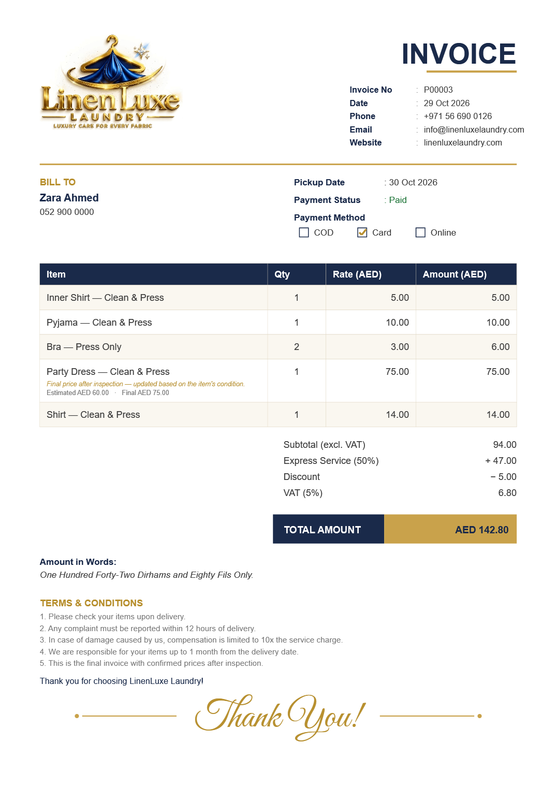
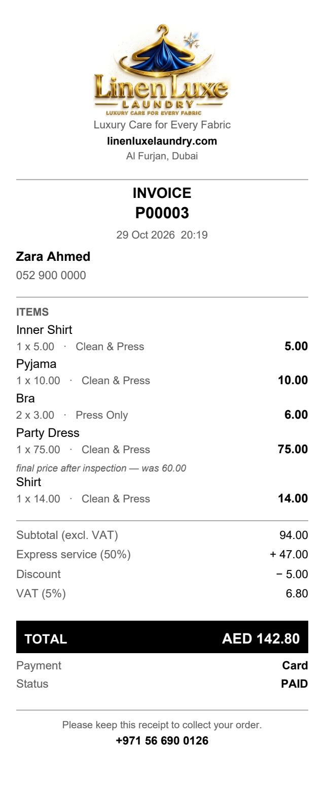
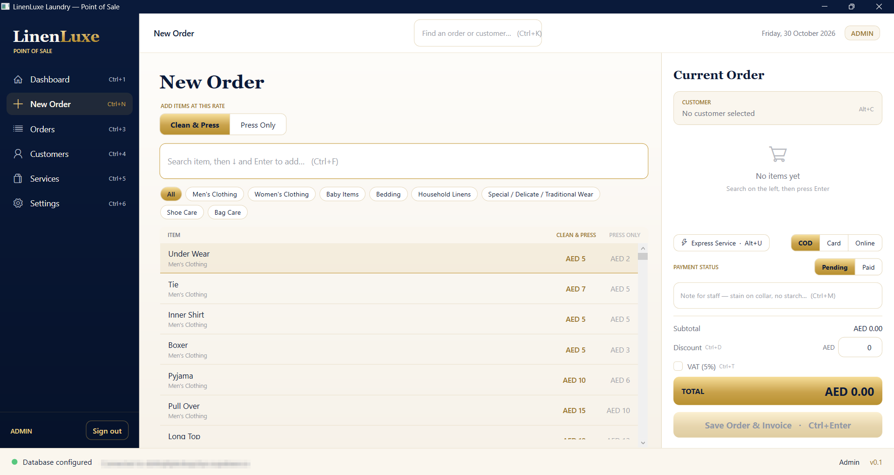
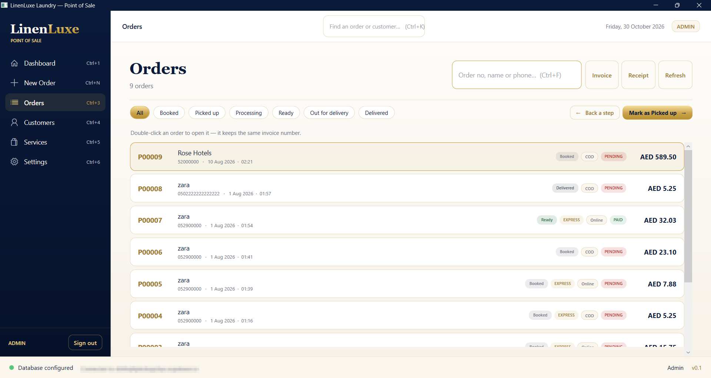
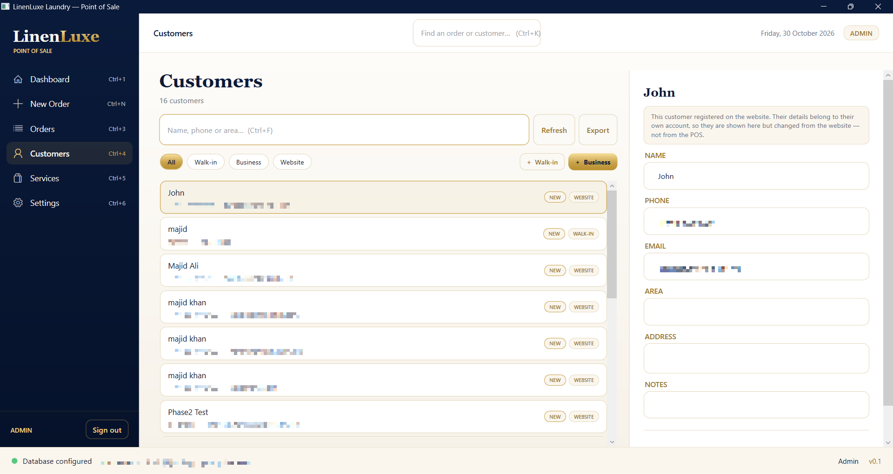
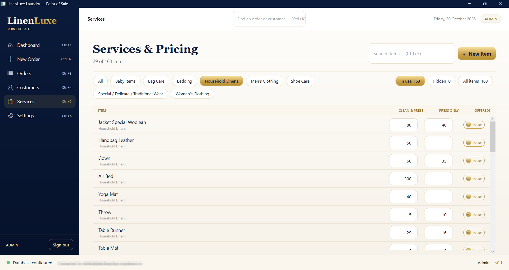
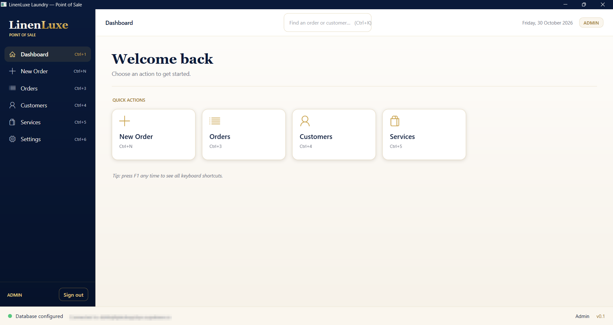

# LinenLuxe POS

A native Windows point of sale for a laundry: take an order at the counter, price
it, print the invoice, and track it through to delivery.

**.NET 10 · WPF · C# · MVVM · Supabase (Postgres + Row Level Security)**

It shares one database with the shop's customer-facing web portal, so a price
changed at the counter is the price the website quotes, and a customer who
registered online is the same customer the till sees.

### 🌐 [www.linenluxelaundry.com](https://www.linenluxelaundry.com) · the portal this works alongside: [linenluxe-portal](https://github.com/majidali32ms-lang/linenluxe-portal)

---

## What it produces

Both documents are generated by the application itself. The A4 invoice is a 1:1
port of the web portal's, so a customer gets the same paper whichever side raised
it.

| A4 invoice (PDF / printer) | 80 mm till receipt |
|---|---|
|  |  |

*Sample data.* Note the fourth line: items priced **after inspection** show what was
estimated and what was finally charged — a laundry cannot price a stain it has not
seen yet, and a general billing app has nowhere to put that.

---

## The screens

Taking an order: the price list on the left, the order being built on the right,
and every figure the counter has to be able to change in one place.



| Orders, from booked to delivered | Customers, with their history |
|---|---|
|  |  |
| Any order reopens for editing and keeps its invoice number. | Walk-ins, business accounts and website registrations in one list. Contact details are blurred here, not in the application. |

| The price list, editable in place | Where everything starts |
|---|---|
|  |  |
| Rates are typed straight into the list; **In use 163 · Hidden 0** says what each view holds, so two filters showing the same rows never looks like a fault. | Four ways in, each with the key that gets there. |

---

## What it does

**Taking an order**
- 163-item price list, searched by relevance, added by typing or double-click
- Clean & Press or Press Only per line, and per-line repricing after inspection
- Express service (+50%), flat discount, VAT on or off, staff note
- Payment method and paid/pending
- Customer attached from the counter's own list or from the website's registrations

**After the order**
- A4 invoice and 80 mm receipt, with a print preview that rasterises the very
  visuals sent to the printer — what is previewed is what prints
- Save as PDF, with the order number pre-filled
- Edit a placed order; it keeps its invoice number
- Status through the shop: booked → picked up → processing → ready →
  out for delivery → delivered

**Customers**
- Walk-ins, business accounts and website registrations in one list, searched by
  name, phone or area
- A business account carries a contact person, the customer's own TRN and credit
  terms; switching a record back to walk-in clears all three, because a counter
  customer with stale credit terms is worse than one with none
- Order history per customer: how many, how much, and what is still unpaid
- Records sharing a phone number are found and merged, with the orders moved across
- Export to CSV
- A customer's first order is discounted automatically

**Pricing**
- Rates edited in the list itself and saved together, so a price rise is one job
  rather than 163
- New items added; items withdrawn by hiding, never deleting, because orders
  already taken name them

The whole thing is keyboard-first — `Ctrl+N` new order, `Ctrl+F` search,
`Alt+C` customer, `Ctrl+Enter` save and invoice. The full list is on the Settings
screen (`F1`).

---

## How it is built

```
src/LinenLuxe.POS/
├─ Models/              # Supabase-mapped records
├─ ViewModels/          # all behaviour and arithmetic, no WPF types
│  └─ Sections/         # one per screen
├─ Views/               # XAML, plus the little code-behind WPF insists on
│  └─ Sections/
├─ Services/
│  ├─ Data/             # Supabase client, order status, customer standing
│  ├─ Invoicing/        # invoice, receipt, print preview, pagination
│  └─ Configuration/    # .env loading, window chrome, shop policy
└─ Themes/Brand.xaml    # every colour, brush and font, in one place
supabase/               # the migrations this app adds, numbered and re-runnable
```

**One drawing routine, two destinations.** The invoice is drawn once against an
`IInvoiceCanvas`. A PDF implementation writes it with PDFsharp; a WPF one draws the
same calls as visuals for the printer and the preview. Two renderers drifting apart
is how a preview comes to lie about what will print.

**Money is rounded as it is produced, not when it is displayed.** Every figure on an
order is stored and reprinted; rounding only at the end lets a saved order show a
total that its own parts do not add up to.

**A price change never reaches an order already taken.** Each order line stores the
price it was sold at, so last month's invoice still explains itself.

**The website's tables are read-only here.** Customers who registered online are
shown and never edited — that data belongs to the live site, and the screen says so
rather than silently disabling the fields.

**A write the database declines is reported as a failure.** PostgREST answers a
write that changed no rows with `200` and an empty list, which is indistinguishable
from success unless you check. A till that says "saved" when nothing saved is worse
than one that refuses.

---

## How it is checked

Everything past the login sits behind a Supabase sign-in, so there is a limit to
what automation can reach unattended. What can be reached is driven by a probe
harness that references the real assembly and exercises the real code:

```
BUILD                                                  ok
price-list row: dirty, valid, and what a price is      ok
customers form: Alt+N / Alt+B and switching type       ok
standing, first-order discount, phone matching         ok
export: phones stay phones                             ok
order totals                                           ok
order status lifecycle                                 ok
what the Supabase client sends for an order            ok
Customers screen builds and renders                    ok
Services screen builds and renders                     ok
clicking OFFERED? actually hides an item               ok
Alt+N, Esc and Ctrl+S reach the Services screen        ok
```

It renders invoices and receipts to PNG, drives the real view models through the
arithmetic, dumps the exact JSON the Supabase client puts on the wire, builds whole
screens and clicks their controls, and raises the key events WPF raises for an Alt
shortcut.

Faults it caught before they reached the counter include a serialiser quietly
sending display properties as database columns, a two-way binding to a read-only
property that closed the entire application, and a rate typed `12,5` being parsed as
**125.00** — ten times the intended price, and charged all day without anybody
noticing.

---

## Running it

1. Install the **.NET 10 SDK**.
2. Copy `.env.example` to `.env` and fill in your Supabase project URL and
   publishable key.
3. Apply the SQL in `supabase/`, in order, in the Supabase SQL editor.
4. ```
   dotnet run --project src/LinenLuxe.POS
   ```

## Security

- Supabase credentials live only in `.env`, which is gitignored and has never been
  committed. Nothing is hard-coded.
- Only the client-safe **publishable** key is used. The database is protected by Row
  Level Security and writes are gated on a staff or admin role. Server-only secrets
  never enter this application.
